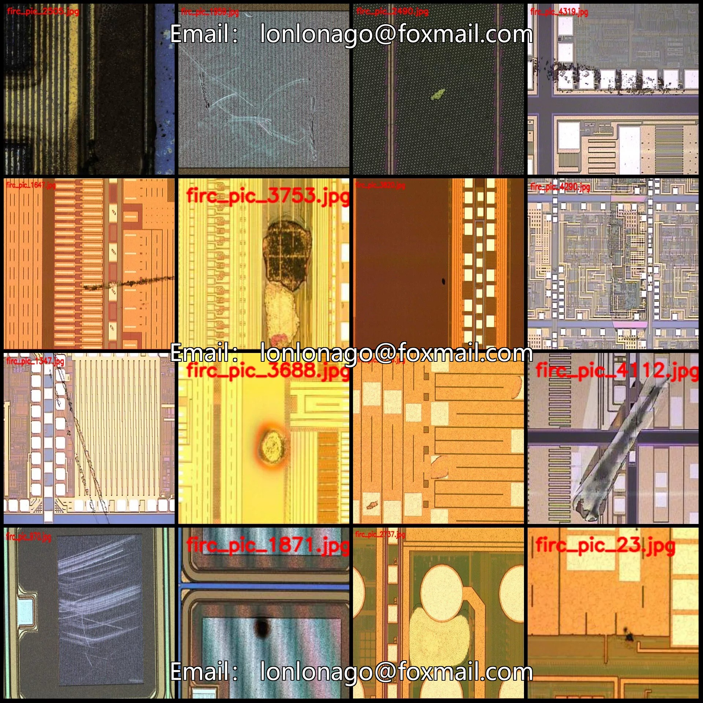
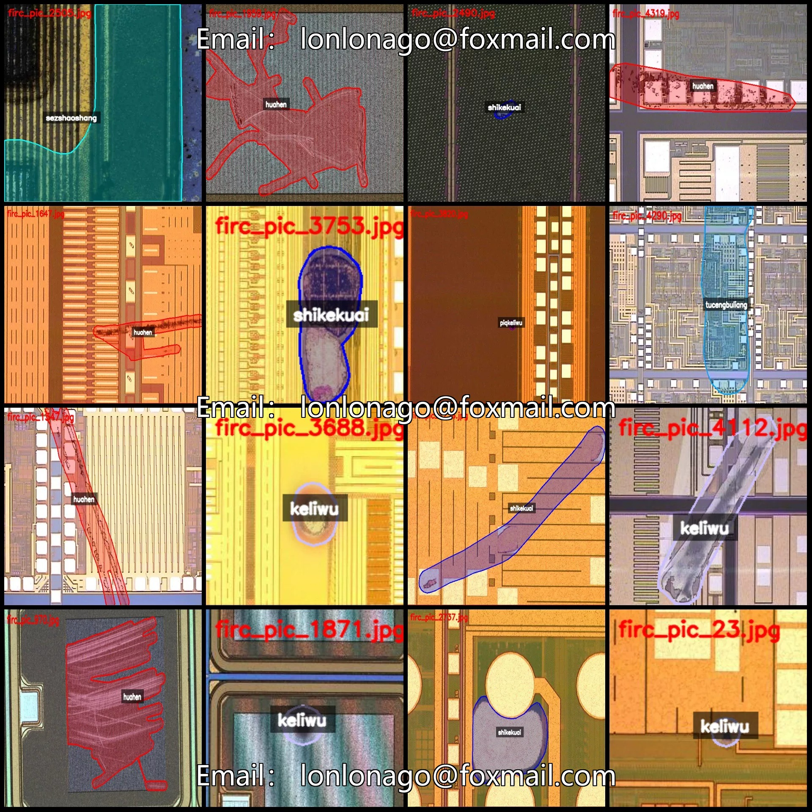
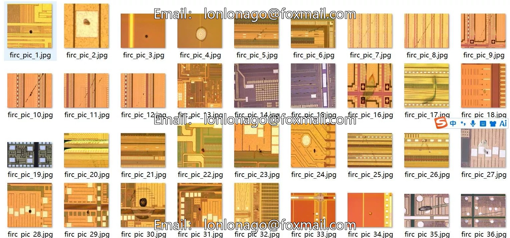
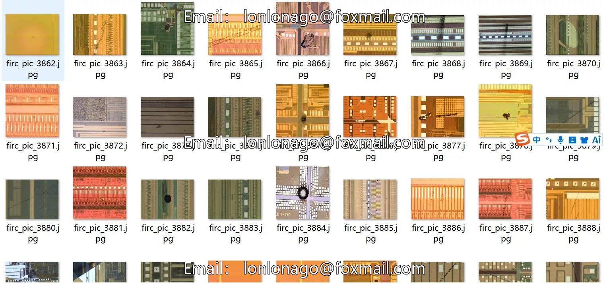
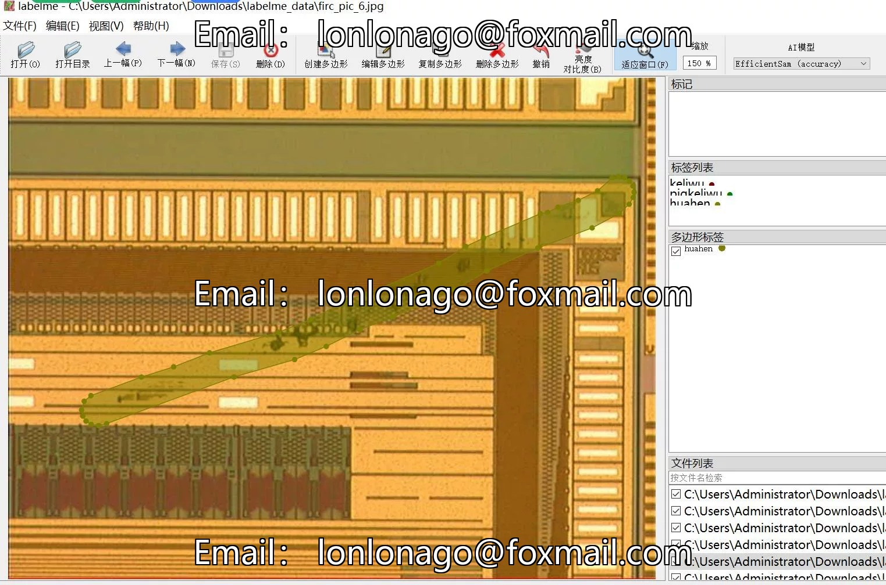
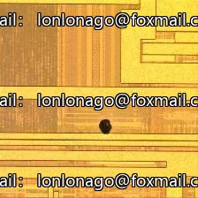
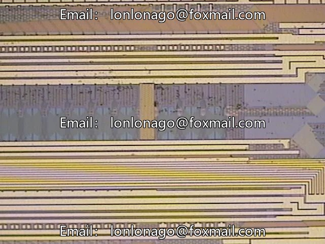

# 453 LabelMe format for micro-defect segmentation dataset of semiconductor chip wafers

## Body

Semiconductor Chip Blanks Micro-Damage Defect Segmentation Dataset - LabelMe Format: 4532 images in 7 categories
Tips: Due to the dataset's replicability, please confirm compliance before purchasing.
Dataset format: LabelMe (excluding mask files, only including jpg images and corresponding json files)
Number of images (number of jpg files): 4532
Number of annotations (number of json files): 4532
Number of annotation categories: 7

Annotation category names: ["huahen", "keliwu", "piqkeliwu", "powuran", "sezshaoshang", "shikekuai", "tucengbuliang"]
Corresponding Chinese Category Names: ["scratch", "particles", "PIQ particles", "PO contamination", "SEZ burn", "etching block", "coating defects"]
Number of boxes labeled in each category
huahen count = 1613
keliwu count = 633
piqkeliwu count = 397
powuran count = 547

The count of boxes is as follows:
- sezshaoshang count = 111
- shikekuai count = 845
- tucengbuliang count = 412
Total number of boxes: 4558
Using labelme tool: labelme=5.5.0
Image resolution: Multi-resolution images, such as 224x224, 742x576, etc.
Annotation rules: Polygon box for categories.
Important note: The dataset can be opened and edited in labelme. For the JSON dataset, it needs to be converted into mask or yolo format or coco format for semantic segmentation or instance segmentation.

Special : This dataset does not guarantee the accuracy of the trained models or weight files.

## Images

## Payment

Here is a pay link on Stripe ( https://buy.stripe.com/3cs8yP7sY87d0vu9AB ). Please contact me lonlonago@foxmail.com after funding $89, and I will send you a complete data files , thank you!

